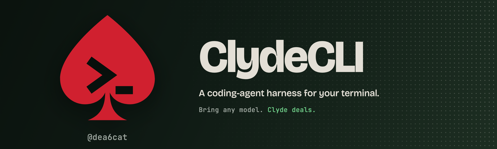

<div align="center">

<h1></h1>

**A coding-agent harness for your terminal, written in Python.**<br>
Bring any LLM; Clyde turns it into an agent.

*"Yeah, I can fix that."*
<br>— Clyde

***

[](https://github.com/dea6cat/ClydeCLI/stargazers)
[](https://polyformproject.org/licenses/noncommercial/1.0.0)
[](https://www.python.org/downloads/)

</div>

***

## 🔥 What This Is

Name's Clyde. I live in your terminal. I read your files, run your commands, pull what I need off the web, and keep at it until the thing works. No speeches. I just fix it.

Strictly, I'm the harness: the agent loop, the tools, the permissions, the sessions.
The brains are whatever LLM you plug in, cloud or local, and with cardShuffle a different one can
play every turn. Model plus harness makes the agent.

Under the hood it's a Python rebuild of the Claude Code architecture. Rebuilt a few times. Still runs.

- **A real agent loop.** It calls tools, streams its replies, remembers the session, and works over many turns.
- **A faithful port.** It keeps the proven architecture, rewritten in idiomatic Python.
- **Built to study and extend.** The code is readable and tested, and you add new skills by writing Markdown.
- **No surprises on the wire.** [What leaves your machine](EGRESS.md) lists every network call, what it sends, and how to turn it off. Your prompts and files go to the model provider you chose and nowhere else.
- **The receipts.** The measurements behind the claims are published as dated notes in [docs/research/](docs/research/): local-model runs, small-model fixes, `clyde tune`'s gates, the October security review, the fine-tuning data.

### ⚡ Quickstart

```bash
curl -fsSL https://raw.githubusercontent.com/dea6cat/ClydeCLI/main/install.sh | sh   # installs uv and Clyde, then walks you through setup
uv tool install --python 3.14 git+https://github.com/dea6cat/ClydeCLI              # already have uv? install straight from git, then `clyde setup`
cd your-project && clyde                                                              # type a task; Clyde asks before it edits a file or runs a command
```

Setup connects a model: any of 13 providers with your key, or one running on your machine (Ollama, or oMLX for MLX models on Apple Silicon). The first run asks you to accept the licence. More install options are [in the install guide](docs/install.md).


***

## ✨ What you get

*One line each. The full story is in [docs/features.md](docs/features.md).*

- **Any model.** 13 providers with your key, or a model on your machine; `cardShuffle` deals a different one each turn.
- **Local models that fit.** `/models local` ranks what your RAM can really run, and `clyde tune` sizes the window for it.
- **Asks first.** Every command that is not read-only asks, and so does anything that reaches outside the project: a command, or a file or folder.
  Allow and deny rules go in `~/.clyde/settings.json`. There is no OS sandbox ([why](CHANGELOG.md)).
- **Undo.** `/rewind` puts back the files the model edited and the conversation.
- **Skills, hooks, MCP, plugins, sub-agents.** Write a skill in Markdown; SkillSpector scans what you install.
- **Bonnie.** `clyde luv bonnie` is the same Clyde in a browser, on localhost.
- **Nothing hidden.** [EGRESS.md](EGRESS.md) lists every network call and how to turn it off.

## 📚 Guides

| | |
|---|---|
| [Install, configure, run](docs/install.md) | the install options, keys, providers, first run |
| [Usage](docs/usage.md) | slash commands, skills, hooks, MCP, modes, updates, memory, plans, rewind, permission rules |
| [Features](docs/features.md) | every feature in detail: providers, local models, cardShuffle, Bonnie, Laya, SkillSpector |
| [Status](docs/status.md) and [FEATURE_LIST.md](FEATURE_LIST.md) | what works, what does not, the roadmap |
| [Telemetry](docs/telemetry.md) | exactly what is counted, where it goes, how to turn it off |
| [Project structure](docs/project-structure.md) | where things live in `src/` |
| [Setup guide](docs/guide/SETUP_GUIDE.md) and [testing guide](docs/guide/TESTING.md) | detailed installation; how the tests run |
| [Research notes](docs/research/) | the measurements behind the claims: local models, small-model fixes, `clyde tune`, the October security review, the fine-tuning data |
| [CHANGELOG.md](CHANGELOG.md) | version history |

## 🔒 Privacy and telemetry

Telemetry is **on for a new install** (an update asks once, default No), with a notice the first time you run Clyde in a terminal.
It sends counts and words from a fixed list, never a prompt, a path, a model's name or an error message. `clyde telemetry show` prints
what is queued, `clyde telemetry off` stops it and deletes the queue, and `DO_NOT_TRACK=1` or `CLYDE_TELEMETRY=off` always win.
Details: [docs/telemetry.md](docs/telemetry.md) and the [privacy page](https://dea6cat.github.io/ClydeCLI/privacy.html).

## 🛡️ Security

*Keep your keys where you keep your lighter. Close, and out of the repo.*

Saved API keys live in `~/.clyde/keys.json`, plain text, readable only by you (mode 600). `.env` files are git-ignored.
To report a vulnerability, see [SECURITY.md](SECURITY.md); please do not open a public issue.

## 🤝 Contributing

*Pull up a chair. Pull requests welcome.*

```bash
pip install -e .[dev]
python -m unittest discover -s tests -t . -q
```

See [CONTRIBUTING.md](CONTRIBUTING.md) for guidelines and [GOVERNANCE.md](GOVERNANCE.md) for how decisions are made.

## 📄 License

Source-available, not open source: free for noncommercial use under the
[PolyForm Noncommercial License 1.0.0](https://polyformproject.org/licenses/noncommercial/1.0.0); commercial use needs
written permission. The first run asks you to accept the terms; [docs/license.md](docs/license.md) has the commands.
Copies obtained before this change remain MIT. See [LICENSE](LICENSE).

***


## 🙏 Acknowledgments

- Based on the Claude Code architecture
- An independent educational project
- Not affiliated with Anthropic

***

<div align="center">

*"Okay. New plan."*

If I fixed something for you, a ⭐ helps. Or don't. I'll still be here.

**Written by dea6cat**

[⬆ Back to Top](#-clydecli)

</div>
